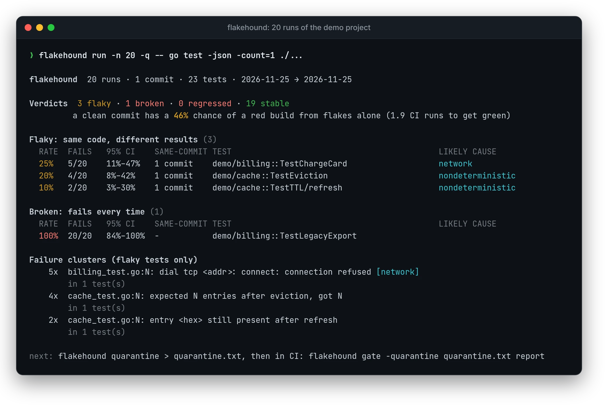

<p align="center">
  
</p>

<p align="center"><b>Find the tests that fail on the same code, prove it with numbers, and stop them blocking your CI.</b><br>
One static Go binary. Reads JUnit XML, <code>go test -json</code>, TAP and Jest JSON.</p>

<p align="center">
  <a href="https://github.com/celaldrg/flakehound/actions/workflows/ci.yml"></a>
  <a href="https://github.com/celaldrg/flakehound/releases"></a>
  <a href="LICENSE"></a>
  
  
</p>

## The problem

Every team with a few thousand tests has a handful that pass or fail at random. Nobody can say which ones, how often, or why. The usual "process" is to click *Re-run failed jobs* and move on, until the day a real regression gets waved through as "just the flaky one".

flakehound answers the three questions with data instead of folklore:

1. **Which tests are flaky?** Same commit, different outcomes. That is the only definition that cannot be argued with. Retry-rescued tests (Surefire `flakyFailure`, Jest `retryTimes`, `gotestsum --rerun-fails`) count too.
2. **How bad is it?** A failure rate with a 95% Wilson confidence interval per test, and the probability that a clean commit goes red because of flakes alone.
3. **What do we do now?** Group failures by root-cause signature, then quarantine the flaky ones so they stop failing builds while real failures still do.

## Why

Flaky tests are not a niche annoyance. They are what engineers complain about most in CI, and the open tooling for them is thin:

- Google reported that about 16% of its tests show some flakiness and that flaky results eat significant engineering time ([Flaky Tests at Google](https://testing.googleblog.com/2016/05/flaky-tests-at-google-and-how-we.html)).
- A 2026 review of 8.8 billion test executions found that 9.8% to 16.3% of failed pipeline runs involved flaky failures ([Harness: The 2026 Flaky-Test Tooling Landscape](https://www.harness.io/blog/flaky-test-tooling-landscape-2026)).
- Uber had to build its own analyzer and ended up with "a lot of flaky tests being ignored in CI, but with no accountable tracking" ([Uber: Flaky Tests Overhaul](https://www.uber.com/ci/en/blog/flaky-tests-overhaul/)).
- Ask HN: ["How do you manage flaky E2E tests at scale?"](https://news.ycombinator.com/item?id=46967724) lists retries everywhere, quarantining, and "slowly losing trust in CI signal"; the Show HN for FlakyBot ([thread](https://news.ycombinator.com/item?id=29028681)) describes teams that "just get used to rerunning the entire suite" with 10-20% flake rates.
- The commercial answers (Trunk, BuildPulse, Datadog, CircleCI) are hosted services that need accounts and upload your test data. A BetterUp case study shows the payoff: CI success from 70% to over 90% once flakes were detected and quarantined ([Trunk](https://www.trunk.io/customers/betterup)).

flakehound is the local, open, one-binary version: no account, no upload, works on any CI because it only needs the report files you already produce.

<p align="center">
  
</p>

## Install

```bash
go install github.com/celaldrg/flakehound@latest
```

or download a binary for Linux, macOS or Windows from the [latest release](https://github.com/celaldrg/flakehound/releases/latest). Go 1.24+, standard library only.

## Example

<p align="center">
  
</p>

Real output, from `examples/demo` (a small Go module whose tests are flaky on purpose: random failures, a tight timeout, a refused connection and one test that is simply broken):

```text
$ flakehound run -n 20 -q -- go test -json -count=1 ./...
flakehound  20 runs · 1 commit · 23 tests · 2026-11-25 → 2026-11-25

Verdicts  3 flaky · 1 broken · 0 regressed · 19 stable
         a clean commit has a 46% chance of a red build from flakes alone (1.9 CI runs to get green)

Flaky: same code, different results (3)
  RATE  FAILS   95% CI    SAME-COMMIT TEST                                           LIKELY CAUSE
  25%   5/20    11%–47%   1 commit    demo/billing::TestChargeCard                   network
  20%   4/20    8%–42%    1 commit    demo/cache::TestEviction                       nondeterministic
  10%   2/20    3%–30%    1 commit    demo/cache::TestTTL/refresh                    nondeterministic

Broken: fails every time (1)
  RATE  FAILS   95% CI    SAME-COMMIT TEST                                           LIKELY CAUSE
  100%  20/20   84%–100%  -           demo/billing::TestLegacyExport                 

Failure clusters (flaky tests only)
    5x  billing_test.go:N: dial tcp <addr>: connect: connection refused [network]
        in 1 test(s)
    4x  cache_test.go:N: expected N entries after eviction, got N
        in 1 test(s)
    2x  cache_test.go:N: entry <hex> still present after refresh
        in 1 test(s)
```

(The demo is random by design, so your numbers will differ.)

## Workflow

### 1. Measure: repeat a command

```bash
flakehound run -n 20 -- go test -json -count=1 ./...
flakehound run -n 10 --report 'junit.xml' -- mvn -q test          # command writes a report file
flakehound run -n 15 -- npx jest --json                           # Jest JSON on stdout
flakehound run -n 30 -stop-on-fail -- ./run-my-tap-tests.sh       # stop at the first failure
```

Every run is stored in `.flakehound/history.jsonl` under the same label (git `HEAD` by default). Same label means same code, so any difference in outcome is flakiness by definition.

### 2. Mine your CI history: ingest reports

```bash
# in CI, after the tests (also when they fail), keep the reports for the commit:
flakehound add -label "$GITHUB_SHA" target/surefire-reports/*.xml
# or download artifacts of the last N runs and ingest them:
flakehound add -label abc1234 -time 2026-11-20T10:00:00Z artifacts/run-1/report.xml
```

Ingesting is idempotent (content-addressed), so re-adding the same artifact does nothing. Re-runs of a commit (GitHub "Re-run failed jobs") share a label, so they are exactly the evidence flakehound needs.

### 3. Read the verdict

```bash
flakehound report                       # text, ranked
flakehound report -format md >> "$GITHUB_STEP_SUMMARY"
flakehound report -format json | jq '.tests[] | select(.verdict=="flaky")'
flakehound report -fail-on-flaky        # exit 1 when any flaky test exists
```

| Verdict | Meaning |
|---|---|
| `flaky` | Failed and passed on the same commit, was rescued by a retry, or flips on/off across commits repeatedly |
| `regressed` | Passed, then started failing and stayed failing: probably a real bug, do not quarantine |
| `broken` | Fails every time |
| `recovered` | Used to fail, passes consistently since |
| `unknown` | Not enough runs yet (`-min-runs`) |

### 4. Stop the bleeding: quarantine and gate

```bash
flakehound quarantine > quarantine.txt          # annotated list, commit it, review it in PRs
flakehound quarantine -format go                # -skip '^(TestA|TestB/sub)$'
flakehound quarantine -format pytest            # --deselect 'tests/test_x.py::TestY::test_z' ...
flakehound quarantine -format jest              # --testNamePattern negative lookahead

# in CI: fail only for failures that are NOT quarantined
flakehound gate -quarantine quarantine.txt report.xml
```

`gate` prints three kinds of line: `FAILED` (blocks the build), `quarantined` (ignored, still visible) and `retried-ok` (passed only after retries). Exit code `1` only when something non-quarantined failed, so a real regression can never hide behind a flaky test.

## How it decides

- **Parsing**: JUnit (Surefire, Gradle, pytest, Jest-junit, Go-junit, with `flakyFailure`/`rerunFailure`), `go test -json` (subtests, rerun streams, package-level build failures, parents explained by failed children are dropped), TAP 13/14 (YAML diagnostics, `# SKIP`, `# TODO`), Jest JSON (`invocations` for retries, suites that failed to run).
- **Stats**: per test, failures over executions, a 95% Wilson interval, flip count, and how many commits saw both a pass and a fail.
- **Suite impact**: `P(red) = 1 - Π(1 - p_i)` over the flaky tests, and expected CI attempts to get green = `1 / (1 - P(red))`.
- **Causes**: failure messages are normalised (numbers, addresses, ids, timestamps, temp paths collapse) and clustered across tests, then labelled by pattern: timeout, network, data race, port in use, rate limit, shared state, resources, missing file/async. If nothing matches, tests that are much slower when failing are flagged as timing-sensitive.

## Architecture

```
main.go                  CLI: run | add | report | quarantine | gate
internal/model           Case, Run, Dedupe (fail+pass in one report => retried)
internal/parse           junit.go gotest.go tap.go jest.go + format detection
internal/store           append-only JSONL history, idempotent, tolerant of corrupt lines
internal/analyze         stats.go (verdicts, Wilson, suite impact) cause.go (signatures, clustering)
internal/quarantine      list file + go / pytest / jest skip-flag renderers
internal/runner          repeated execution, per-run reports, timeouts, cancellation
internal/render          text, Markdown, JSON
```

Single static binary, no dependencies, no network access, no telemetry.

## Development

```bash
go test -race ./...
go vet ./...
```

The tests cover every parser against realistic fixtures (including malformed input), the statistics against known Wilson values, every verdict transition, the runner with a self-executing helper process (timeouts, cancellation, missing binaries, garbage output), and the CLI end to end (add, report, quarantine, gate).

## Credits

Inspired by the flaky-test write-ups from Google and Uber linked above, and by the Wilson score interval (E. B. Wilson, 1927). Not affiliated with any of the commercial tools mentioned.

## License

[MIT](LICENSE)
